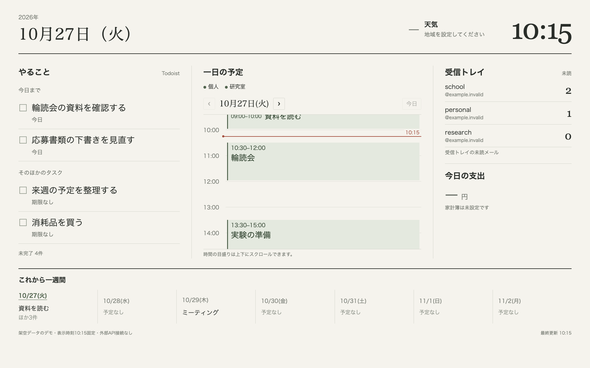
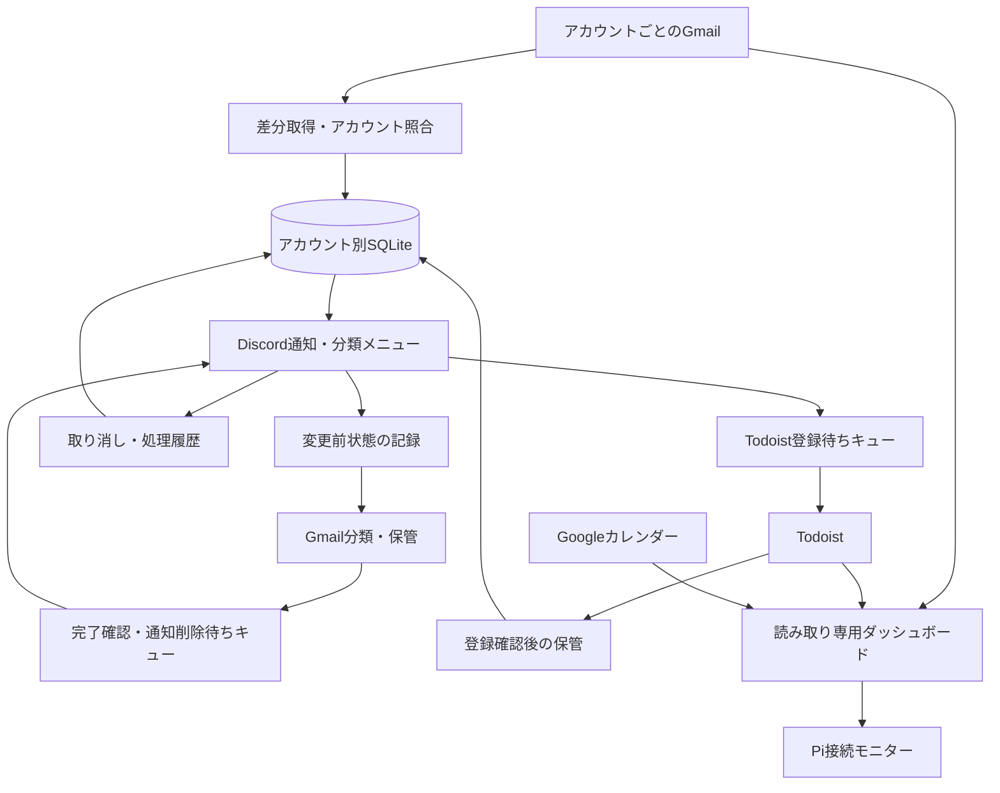

# Pi Mailbot

**複数のGmailをDiscordから仕分けし、タスクと予定をRaspberry Piの常設画面で確認する個人用情報整理システムです。** Python / SQLite / discord.py / Gmail APIを使用しています。

> 個人開発のポートフォリオ用スナップショットです。開発には **OpenAI Codex** を活用し、実装・修正・調査に生成AIの支援を取り入れています。運用中の認証情報・メール・予定・画像・データベースは含みません。

## 開発の背景と解決したかった課題

大学・個人用など複数のメールアカウントを使う中で、「確認したが整理していないメール」が残り、必要な情報を探し直す手間がありました。メールの確認から内容の分類、保管、タスク化までを短い操作で行い、処理後は未整理の通知だけが残る仕組みを目指して開発しました。

Raspberry Pi 3 Model B+でBotを常時稼働させ、接続したモバイルモニターにはTodoist・Googleカレンダー・メール件数を表示します。Macで開発し、Linuxのsystemdサービスとして運用する構成です。

## 主要機能

| 機能 | 実装内容 |
| --- | --- |
| 複数Gmailの通知 | アカウント別OAuth、専用SQLite、Discordチャンネルへの振り分け |
| 内容の複数分類 | 学校・研究・生活／手続き・お金・就活・買い物／配送・広告／お知らせ |
| 分類して保管 | 内容ラベル付与とアーカイブをまとめて行い、成功後に元通知を削除 |
| メールの整理 | 要対応・あとで読む・保管・ゴミ箱への移動。永久削除はしない |
| 取り消し・履歴 | 変更前ラベルを保存し、直後の取り消しボタンと短い処理履歴を提供 |
| Todoist | メールからタスクを作成し、外部登録の確認後に保管する経路 |
| デスク画面 | タスク、日単位の予定タイムライン、週間予定、メール件数 |
| ローカル記録 | 手動のゲームクレジット記録、画像の検査・重複判定・保存 |
| 任意のAI要約 | 件名・短い抜粋を対象とするGemini連携。既定は無効 |

機能ごとの実装・実サービスでの確認・未確認の区別は [機能状況](docs/STATUS.md) に記載しています。

## 画面例



公開用のデモが返す**架空のタスク・予定・メール件数**で表示した画面です。Google・Discord・Todoistへの接続を行わず、実際のメールやカレンダーは使っていません。

## 使用技術

| 役割 | 技術 |
| --- | --- |
| 言語 | Python 3.11以上、JavaScript、HTML / CSS |
| Discord | discord.py、スラッシュコマンド、永続ボタン、選択メニュー |
| メール | Gmail REST API、OAuth 2.0、historyIdによる差分取得 |
| 永続化 | SQLite、WAL、アカウント別DB、処理前の記録 |
| 外部連携 | Todoist API、Google Calendar API、任意のGemini API |
| 画面 | 標準ライブラリのHTTPサーバー、日単位タイムライン、JST表示 |
| 運用 | Raspberry Pi OS Lite 32bit、systemd、ローカル専用HTTP |

## システム構成



詳細は [アーキテクチャ](docs/ARCHITECTURE.md) を参照してください。

## 開発で工夫した点

- **アカウントを取り違えない**：OAuthの取得先メールアドレスを照合し、通知ID・サーバー・チャンネルをDBに保存して操作対象を限定します。
- **失敗と成功を分ける**：Gmailの処理完了とDiscord通知の削除を別に管理し、通知削除だけ失敗してもメール操作を繰り返さない設計です。
- **誤操作から戻せる**：変更前のラベルと管理対象IDを記録し、履歴から復元します。古い取り消しボタンで後の再分類を戻さないよう世代を照合します。
- **重複処理を抑える**：GmailメッセージID、アカウント別キュー、決定的なタスク識別子を利用します。ただし外部送信とDB更新の間の停止で通知が重複する余地はあります。
- **常時表示を読みやすくする**：大きな日本語、予定の重なりを考慮したタイムライン、未処理メールがある間の強調表示を実装しました。
- **外部連携を任意にする**：外部アカウントがなくてもCLIと画面デモを動かせます。AI送信は明示的な設定・同意が必要です。

## セットアップ

```bash
git clone https://github.com/yuzu-rhythm/PiMailbot.git
cd PiMailbot
python3 -m venv .venv
source .venv/bin/activate
python -m pip install -e .
```

### 外部アカウント不要のデモ

```bash
# 架空データで予定・タスク・メール件数の画面を表示
python examples/dashboard_demo.py
# ブラウザで http://127.0.0.1:8877/ を開く。Ctrl+Cで停止。
```

```bash
# 架空メールの通知と操作予定をローカルSQLiteで確認
python -m mailbot mail --mail-db data/portfolio-mail.sqlite3 demo
# タスク・手動クレジットなどのオフラインデモ
python -m mailbot --db data/portfolio.sqlite3 --image-dir data/portfolio-images demo
```

これらは実メールを読み書きしません。画面デモはループバックのみで待ち受けます。

### Discord・Gmailなどの接続

[セットアップ手順](docs/SETUP.md) に記載しています。`.env.example` は空の認証値と無効の連携フラグを含む雛形です。実際のBotトークン、OAuthファイル、APIキーは各自で用意し、Git除外された非公開ファイルへ保存します。

## ディレクトリ構成

```text
src/mailbot/       Bot・Gmail・Todoist・Calendar・SQLite・画面
tests/             既存のunittestテストコード
scripts/           秘密値を非表示で保存する設定補助
examples/          架空メールと外部接続不要の画面デモ
deploy/            systemdサービスの例
docs/              設計・設定・機能状況・確認範囲
```

## 動作確認と制約

公開コピーの構文確認、パッケージ作成、架空データのデモ確認結果は [検証記録](docs/VALIDATION.md) を参照してください。**この公開作業では既存の自動テストを実行していません。** テストコードの同梱と、最新機能のテスト通過は区別しています。

開発環境では5アカウントの認証と通知、ラベル作成・改名、Piのサービス起動などを確認しています。一方、最新の「分類して保管 → 通知削除 → 取り消し」の一連操作や、通信断・長時間連続運用は確認範囲が限られます。実データの画面・認証情報・運用ログは公開していません。

## 今後の改善

- Gmailを操作する画面と、複数アカウント横断の分類別閲覧を改善
- 分類・保管・復元・通信断を含む統合確認と自動テストを拡充
- Gmail/Discordの処理中断時の重複・復旧を改善
- OAuthの再認証、バックアップ復元、依存関係の更新手順を整備
- 音ゲーの自動画像・レート・クレジット差分取得を別途検討

管理用Gmailへの選択転送、家計簿の自動連携、天気取得、音ゲーの自動取得、写真保存サーバーは、この公開版の完成機能ではありません。

## 公開・ライセンス

- [公開内容とセキュリティ点検](docs/SECURITY_REVIEW.md)
- [第三者ライブラリ・素材の扱い](THIRD_PARTY_NOTICES.md)
- [機能状況](docs/STATUS.md)

このスナップショットでは、オリジナルコード全体に新しいOSSライセンスを付与していません。再利用・再配布の許諾範囲は作者が別途選択します。第三者ライブラリには各ライセンスが適用されます。
